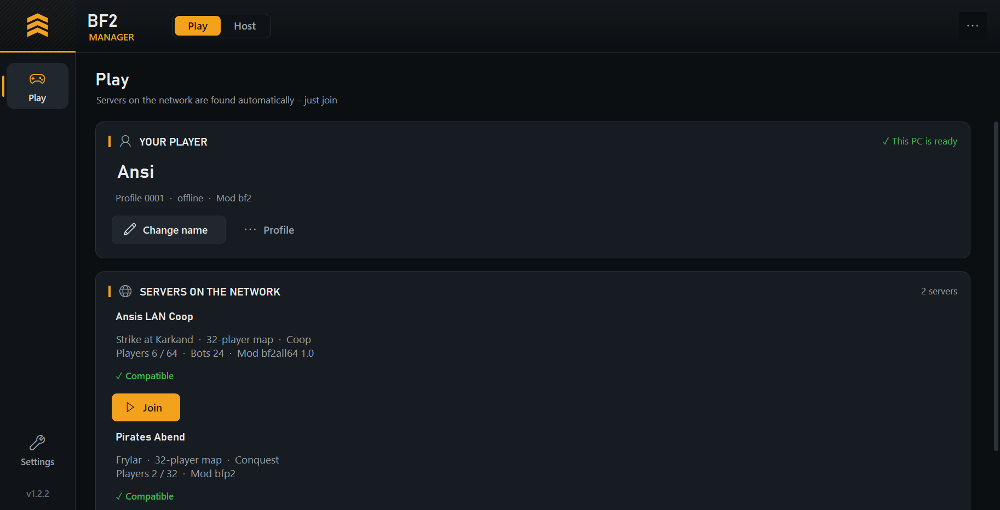
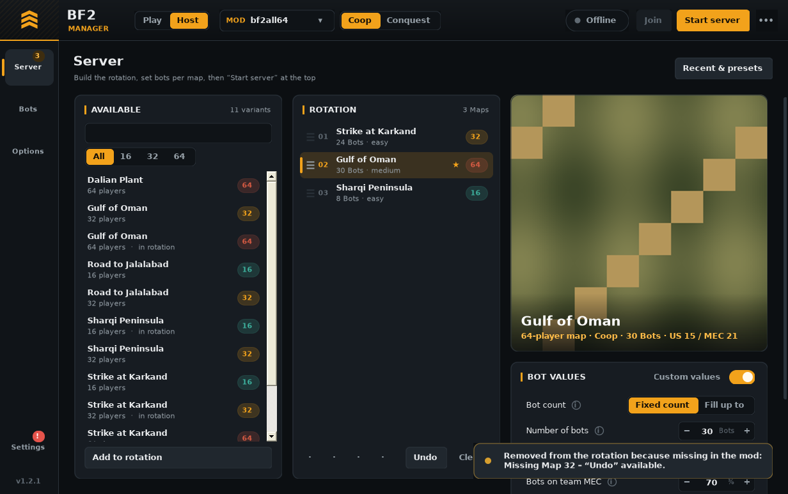

# BF2 Manager

**The Battlefield 2 launcher for LAN parties: find the server and join with one click – or host a coop server with bots.**

### [⬇ Download BF2Manager.exe (latest version)](https://github.com/AnselmJo/bf2-manager/releases/latest/download/BF2Manager.exe)

Click, save, start – that's it. Windows SmartScreen may warn because the file is not signed: *More info › Run anyway*. Checksum: [SHA256SUMS.txt](https://github.com/AnselmJo/bf2-manager/releases/latest/download/SHA256SUMS.txt) · [all releases](https://github.com/AnselmJo/bf2-manager/releases) · the manager updates itself afterwards.

One single `.exe`, no installation, German and English. Two modes, switched at the top left:

| **Play** | **Host** |
|---|---|
| Servers on the network appear automatically – click **Join**. Map, size, mode, players, bots, mod and compatibility at a glance. | Build a rotation, set bots per map, start the server. While it runs: live view with players, upcoming maps and actions. |

## Features

**Play**
- Automatic server discovery on the LAN – no IP addresses
- **Join compatibility:** mod present and same version? If not, fetch the files from the server PC with one click
- **First-start window:** game folder and player name in one step – the manager creates the BF2 profile
- **Profiles in the manager:** change name (applies right away), new, repair (when BF2 hangs), delete – always with a backup
- Health check: one **Fix** button when something is missing (DirectX 9, firewall, 4 GB patch, unlock weapons, player name)
- Settings: graphics and audio presets, windowed mode, skip intro, optional ReShade with setup guide, mods, updates, diagnostics

**Host** (includes everything above plus a **Join** button for your own server)
- **Rotation with previews:** drag handles, right-click menu, shuffle, filter by map size, undo
- **Bots per map** (★ custom values) and defaults per map size in one place, adaptive difficulty, bot radio on/off
- **Live view** when the server runs: players with kick, upcoming maps, next map, restart round, message to all, console with command assistant, scheduled messages, evening leaderboard
- **Clear timing:** ⚡ applies immediately · rotation and bots from the next map · everything else after a restart (one click)
- **Your own default** for all mods, **recently started** configurations and presets
- Automatic restart when the server crashes or hangs, start check before launching
- Everything is saved automatically

## Quick start

1. Download **[`BF2Manager.exe`](https://github.com/AnselmJo/bf2-manager/releases/latest/download/BF2Manager.exe)** (always the latest version).
2. Put it into your Battlefield 2 folder (next to `BF2.exe`) – or anywhere, it finds the game.
3. Start it (SmartScreen: *More info › Run anyway*), enter your player name, click **Fix** if the bar is yellow.
4. **Play:** click **Join** on a server. **Host:** switch to *Host* at the top left and follow the one-time setup.

Preparing a LAN party? **[docs/LAN-PARTY.md](docs/LAN-PARTY.md)** – one folder, everything inside.

## Documentation

- [User guide](docs/USER-GUIDE.md) · [LAN party guide](docs/LAN-PARTY.md) · [Building](docs/BUILDING.md) · [Architecture](docs/ARCHITECTURE.md) · [Changelog](CHANGELOG.md)

## Requirements

Windows 10/11 (.NET Framework 4.5+ is part of Windows) and Battlefield 2 with patch 1.5. Tested mainly with the mod **bf2all64**; hosting works with any mod that has `python/game/scoringCommon.py`.

## FAQ

**No server appears.** Run *Fix* on both PCs (firewall). Same network? For VPN LANs (Radmin, ZeroTier, Hamachi) use *Server not found?* and enter the IP.
**Join stops at the login screen.** *Settings › Game start › Log in automatically* must be on and an offline profile selected.
**Game freezes when joining.** *Play › Profile › Repair profile*; switch ReShade off if installed; check on the server PC that the server is still running.
**No unlock weapons.** Host: *Options › Server behaviour › all unlocks*. Every player: *Fix* (client unlock).

## Deutsch

**[⬇ BF2Manager.exe herunterladen (neueste Version)](https://github.com/AnselmJo/bf2-manager/releases/latest/download/BF2Manager.exe)**

Der BF2 Manager ist komplett zweisprachig (*Einstellungen › Sprache*). Exe herunterladen, starten (SmartScreen: *Weitere Informationen › Trotzdem ausführen*), Spielordner und Namen bestätigen – Server erscheinen automatisch, **Beitreten** klicken. Wer hostet, schaltet oben links auf **Hosten**. Updates holt sich der Manager danach selbst.

## License and disclaimer

MIT License, see [LICENSE](LICENSE). Fan project, not affiliated with or endorsed by Electronic Arts or DICE. Battlefield 2 is a trademark of Electronic Arts Inc. No game files included.
